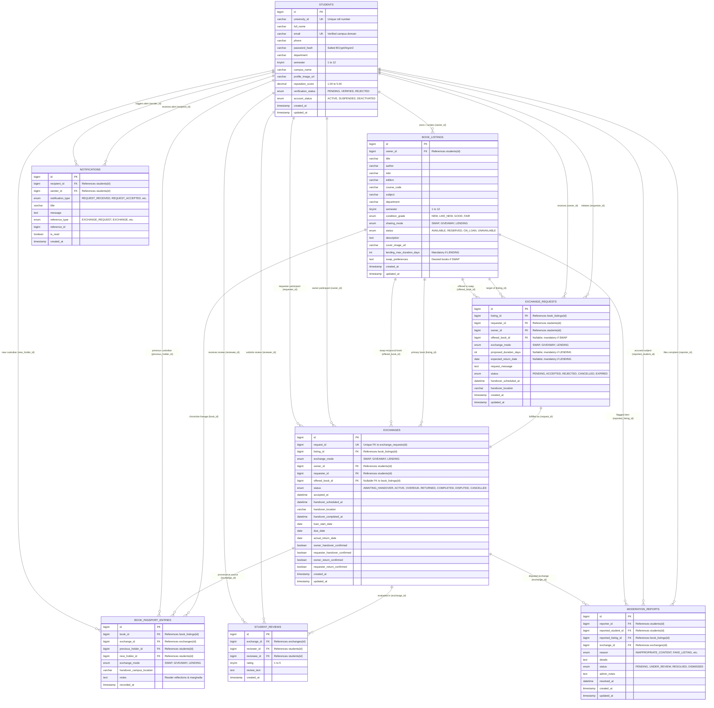

# Book4u — Complete Entity-Relationship (ER) Architecture

## 1. Executive Summary

This document defines the formal relational database architecture for **Book4u**, a university campus peer-to-peer textbook sharing platform.

The schema is normalized to **Third Normal Form (3NF)**, strictly enforces relational constraints, and encapsulates the state machines for the three supported sharing modes:
1. **SWAP** — Mutual bilateral book exchange with reciprocal ownership transfer.
2. **GIVEAWAY** — Altruistic book transfer with zero return or financial obligation.
3. **LENDING** — Time-bound custody with return tracking (`ACTIVE`, `OVERDUE`, `RETURNED`, `DISPUTED`).

---

## 2. Complete Mermaid ER Diagram

---

## 3. Relationship Cardinalities & Business Invariants

| Parent Table | Child Table | Foreign Key Column | Cardinality | Business Invariant & Delete Rule |
| :--- | :--- | :--- | :--- | :--- |
| `students` | `book_listings` | `owner_id` | **1 to N** | `ON DELETE RESTRICT`. A student account cannot be deleted if active listings exist. Deactivation (`account_status = 'DEACTIVATED'`) is used instead. |
| `book_listings`| `exchange_requests`| `listing_id` | **1 to N** | `ON DELETE CASCADE`. Unfulfilled negotiation requests are purged if an un-exchanged listing is deleted. |
| `students` | `exchange_requests`| `requester_id` | **1 to N** | `ON DELETE CASCADE`. Pending requests belong to the requesting student. |
| `students` | `exchange_requests`| `owner_id` | **1 to N** | `ON DELETE CASCADE`. |
| `exchange_requests`| `exchanges` | `request_id` | **1 to 1** | `ON DELETE RESTRICT`. Exactly one exchange contract per accepted request. Enforced by `UNIQUE (request_id)`. |
| `book_listings`| `exchanges` | `listing_id` | **1 to N** | `ON DELETE RESTRICT`. Preserves transaction history. |
| `students` | `exchanges` | `owner_id`, `requester_id` | **1 to N** | `ON DELETE RESTRICT`. Completed transactions must persist for campus audit records. |
| `book_listings`| `book_passport_entries`| `book_id` | **1 to N** | `ON DELETE CASCADE`. A book's journey is tracked chronologically. |
| `exchanges` | `book_passport_entries`| `exchange_id` | **1 to N** | `ON DELETE SET NULL`. Preserves book journey entries even if exchange records are archived. |
| `exchanges` | `student_reviews` | `exchange_id` | **1 to 2** | `ON DELETE CASCADE`. At most 2 reviews per exchange (one from each student participant), enforced by `UNIQUE (exchange_id, reviewer_id)`. |
| `students` | `notifications` | `recipient_id` | **1 to N** | `ON DELETE CASCADE`. |
| `students` | `moderation_reports`| `reporter_id` | **1 to N** | `ON DELETE RESTRICT`. Moderation complaints cannot be deleted by student action. |

---

## 4. Indexing Strategy Matrix

| Table | Index Name | Columns Indexed | Query Target / Optimization |
| :--- | :--- | :--- | :--- |
| `students` | `idx_students_email` | `(email)` | Fast authentication lookup |
| `students` | `idx_students_dept_verif` | `(department, verification_status)` | Campus directory & moderation filters |
| `book_listings` | `idx_books_owner` | `(owner_id)` | "My Books" profile view |
| `book_listings` | `idx_books_title` | `(title)` | Search autocomplete & title queries |
| `book_listings` | `idx_books_subject` | `(subject)` | Browse by academic subject area |
| `book_listings` | `idx_books_dept_sem` | `(department, semester)` | Semester syllabus book discovery |
| `book_listings` | `idx_books_mode_status`| `(sharing_mode, status)` | Filter marketplace by SWAP / GIVEAWAY / LENDING and AVAILABLE |
| `book_listings` | `idx_books_course` | `(course_code)` | Fast lookup by campus course code (e.g., `CS201`) |
| `exchange_requests` | `idx_requests_listing_status`| `(listing_id, status)` | Incoming requests per book |
| `exchange_requests` | `idx_requests_requester_status`| `(requester_id, status)` | Student's active outgoing requests |
| `exchange_requests` | `idx_requests_owner_status` | `(owner_id, status)` | Student's pending incoming requests |
| `exchange_requests` | `idx_requests_duplicate_check` | `(listing_id, requester_id, status)` | Instant duplicate request prevention |
| `exchanges` | `idx_exchanges_participants_status`| `(owner_id, requester_id, status)` | User exchange overview dashboard |
| `exchanges` | `idx_exchanges_due_date`| `(due_date)` | Daily cron job checking for overdue loans |
| `book_passport_entries`| `idx_passport_book_date`| `(book_id, recorded_at DESC)`| Book Passport public reading journey timeline |
| `student_reviews` | `idx_reviews_reviewee_rating`| `(reviewee_id, rating)` | Student reputation score aggregation |
| `notifications` | `idx_notifications_recipient_read`| `(recipient_id, is_read, created_at DESC)` | Student in-app notification dropdown / inbox |
| `moderation_reports` | `idx_reports_status` | `(status, created_at DESC)` | Admin dispute review queue |

---

## 5. Database Normalization (3NF)

1. **First Normal Form (1NF):**
   - All columns contain atomic, scalar values (no array columns, no delimited strings).
   - Each table has a unique primary key (`id` BIGINT AUTO_INCREMENT).
2. **Second Normal Form (2NF):**
   - Every non-key attribute is fully functionally dependent on the primary key.
   - Composite keys are eliminated in favor of surrogate primary keys with composite uniqueness constraints.
3. **Third Normal Form (3NF):**
   - Transitive dependencies are removed.
   - For example: Listing status and exchange status are not stored redundantly in `students`; reviews point directly to `exchanges(id)` rather than storing redundant book details; passport entries reference `book_id` and `exchange_id` without duplicating book titles or student names.
