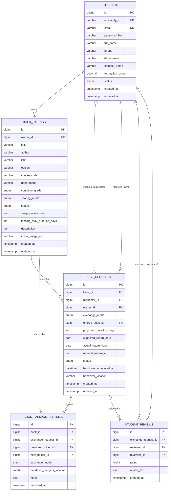

# Book4u — Database Design Document

## 1. Relational Database Overview

- **Database Engine:** MySQL 8.x
- **Storage Engine:** InnoDB (ACID compliant, foreign key enforcement)
- **Character Set:** `utf8mb4` with `utf8mb4_unicode_ci` (full Unicode and emoji support for student notes)
- **Data Access Layer:** Spring JDBC (`JdbcTemplate`, `NamedParameterJdbcTemplate`) with parameterized SQL
- **Connection Pool:** HikariCP

---

## 2. Entity-Relationship Model



---

## 3. Normalization & Integrity Guarantees

1. **Third Normal Form (3NF):** Every non-key attribute depends strictly on the primary key, avoiding transitive dependencies.
2. **Strict Mode Invariance:**
   - Books listed under `SWAP` can specify `swap_preferences`.
   - Books listed under `LENDING` define `lending_max_duration_days`.
   - Books listed under `GIVEAWAY` require neither.
   - Absolutely no price, currency, or payment columns exist in the database, preserving the student peer-to-peer non-commercial design.
3. **Foreign Key Cascades & Safety:**
   - Deleting a listing cascades to its active requests and passport links.
   - Offered books in swap requests utilize `ON DELETE SET NULL` to avoid cascading data loss on reciprocal listings.

---

## 4. Indexing Strategy

To ensure sub-millisecond query latency across thousands of campus listings:

| Table | Index Name | Columns | Purpose |
| :--- | :--- | :--- | :--- |
| `students` | `idx_students_email` | `(email)` | Fast authentication lookup |
| `students` | `idx_students_dept` | `(department)` | Filtering students by faculty/dept |
| `book_listings` | `idx_books_owner` | `(owner_id)` | "My Listings" user profile query |
| `book_listings` | `idx_books_sharing_mode` | `(sharing_mode)` | Filtering by SWAP / GIVEAWAY / LENDING |
| `book_listings` | `idx_books_status` | `(status)` | Excludes EXCHANGED/ARCHIVED books from discovery |
| `book_listings` | `idx_books_course` | `(course_code)` | Fast lookup by campus course (e.g. `CS101`) |
| `book_listings` | `idx_books_title` | `(title)` | Search autocomplete & matching |
| `exchange_requests` | `idx_requests_listing` | `(listing_id)` | Request list per book |
| `exchange_requests` | `idx_requests_requester`| `(requester_id)`| "My Outgoing Requests" query |
| `exchange_requests` | `idx_requests_owner` | `(owner_id)` | "My Incoming Requests" query |

---

## 5. Parameterized SQL & Spring JDBC Execution

All database interactions will be implemented using Spring's `JdbcTemplate` and parameterized queries:

```java
// Example: Safe parameterized search query without SQL injection risk
String sql = """
    SELECT id, owner_id, title, author, course_code, sharing_mode, condition_grade, status 
    FROM book_listings 
    WHERE status = 'AVAILABLE' 
      AND sharing_mode = ? 
      AND department = ?
    ORDER BY created_at DESC
""";

List<BookListing> listings = jdbcTemplate.query(
    sql,
    new BookListingRowMapper(),
    sharingMode.name(),
    department
);
```
