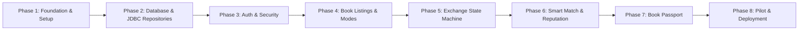

# Book4u — Development Roadmap

This roadmap establishes the phased engineering lifecycle for the Book4u campus book exchange platform.

---

## Roadmap Overview

---

## Phase Breakdown

### Phase 1: Foundation & Setup *(Current Phase)*
- [x] Establish monorepo structure (`frontend/`, `backend/`, `database/`, `docs/`).
- [x] Initialize React frontend with Vite, React Router, Axios, and clean layout placeholder.
- [x] Initialize Spring Boot 3.x backend on Java 21 with Spring JDBC and Web starters.
- [x] Configure environment variables and credentials protection (`.env.example`, `.gitignore`).
- [x] Implement `/api/health` diagnostic endpoint and configure local CORS policies.
- [x] Deliver initial schema DDL (`database/schema.sql`) and architectural documentation.

---

### Phase 2: Database Execution & Spring JDBC Data Access Layer
- [ ] Execute MySQL 8.x DDL on local/staging database instance.
- [ ] Implement core domain models (`Student`, `BookListing`, `ExchangeRequest`, `BookPassport`).
- [ ] Implement Spring `RowMapper<T>` classes for all domain entities.
- [ ] Build parameterized SQL repositories using `JdbcTemplate` and `NamedParameterJdbcTemplate`:
  - `StudentRepository`
  - `BookListingRepository`
  - `ExchangeRequestRepository`
  - `BookPassportRepository`
- [ ] Unit and integration tests for all JDBC repositories with H2/Testcontainers.

---

### Phase 3: Campus Authentication & Spring Security
- [ ] University email domain verification (`@*.edu` / `@campus.edu`).
- [ ] Spring Security configuration with stateless JWT authentication.
- [ ] Password hashing using BCrypt.
- [ ] Registration, Login, and Student Profile endpoints.
- [ ] Frontend Authentication Context, Protected Routes, and JWT Axios interceptors.

---

### Phase 4: Book Listings & Multi-Mode Operations
- [ ] Book listing creation, editing, and archiving endpoints.
- [ ] Strict mode enforcement:
  - `SWAP`: swap book preferences validation.
  - `GIVEAWAY`: zero-return terms.
  - `LENDING`: maximum lending duration and return date validation.
- [ ] Course code and department categorization.
- [ ] Search, filter, and pagination by mode, department, course, and condition.
- [ ] Responsive Frontend Book Marketplace & detail views.

---

### Phase 5: Exchange Request State Machine & Handover
- [ ] State-machine workflow for requests:
  `PENDING -> ACCEPTED / REJECTED -> HANDOVER_SCHEDULED -> COMPLETED -> RETURNED (Lending)`
- [ ] Campus handover scheduler (date/time, campus meeting point).
- [ ] Handover confirmation mechanism (dual student confirmation).
- [ ] Automated reminders for lending return dates.

---

### Phase 6: Smart Match Recommendation & Student Trust
- [ ] Direct Swap Match algorithm: pairs Student A (wants book X, has book Y) with Student B (wants book Y, has book X).
- [ ] Three-way circular swap resolution engine.
- [ ] Post-exchange mutual review system (1–5 stars, feedback tags).
- [ ] Student reputation scoring calculation.

---

### Phase 7: Digital "Book Passport" & Reader Journey
- [ ] Automatic passport history entry creation upon handover completion.
- [ ] Book journey timeline visualization on frontend.
- [ ] Reader note and marginalia passing system between student custodians.
- [ ] Campus reading legacy badges.

---

### Phase 8: Admin Dashboard, Analytics & Campus Launch
- [ ] Campus admin oversight panel for flagged listings and reports.
- [ ] Environmental savings metrics (paper saved, academic money preserved).
- [ ] Production containerization (Docker, Docker Compose).
- [ ] Campus pilot launch across pilot faculties.
