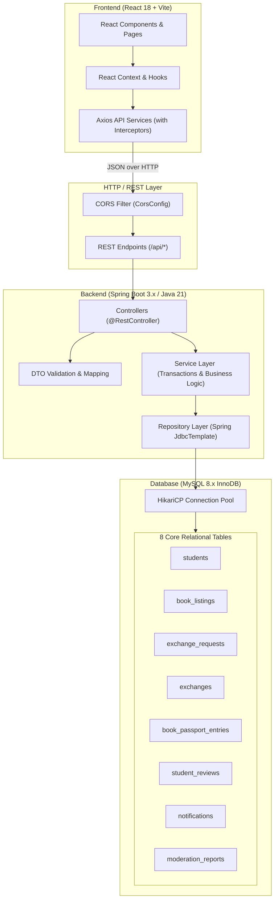

# Book4u — System Architecture Document

## 1. Architectural Philosophy

Book4u is built on a clean, decoupled, layered architecture prioritizing **transparency, testability, predictable performance, and strict separation of concerns**.

Unlike conventional enterprise systems that obscure SQL through Object-Relational Mapping (ORM) frameworks like Hibernate or JPA, Book4u intentionally utilizes **Spring JDBC** (`JdbcTemplate` / parameterized SQL). This design decision provides:

1. **Explicit Query Control:** Direct, hand-tuned, index-optimized SQL queries without hidden N+1 queries.
2. **Pedagogical Clarity:** Demonstrates relational database concepts, PreparedStatements, explicit RowMappers, and transaction boundaries.
3. **Low Memory Footprint:** Eliminates first-level/second-level entity caches, dirty-checking overhead, and proxy session leaks.
4. **Resilient Data Contracts:** Clear boundaries between relational tables and API response DTOs.
5. **Zero Commercial Transactions:** Architecture strictly governs peer-to-peer sharing (SWAP, GIVEAWAY, LENDING) with no payment or shopping cart components.

---

## 2. Layered Architecture Overview

---

## 3. Component Breakdown & Responsibilities

### 3.1 Client Layer (`frontend/`)
- **Technology:** React 18+, Vite, React Router, Axios, CSS Modules / modern CSS.
- **Role:** Pure client-side presentation and interaction. Communicates with the backend exclusively via RESTful JSON payloads.
- **Key Tenet:** Never stores or expects backend secrets. Uses `VITE_API_BASE_URL` to route requests.

### 3.2 Presentation / Controller Layer (`com.book4u.controller`)
- **Role:** Exposes RESTful endpoints, handles HTTP routing, and consumes/produces JSON.
- **Invariants:**
  - Controllers **never** interact with the database directly.
  - Controllers **never** contain business rules.
  - All incoming payload validation occurs via `@Valid` and Bean Validation annotations.

### 3.3 Service Layer (`com.book4u.service`)
- **Role:** Implements domain rules, orchestrates transactions, enforces invariants, and coordinates cross-repository operations.
- **Transaction Management:** Uses Spring's declarative `@Transactional` at service boundaries to ensure atomicity across JDBC statements. Employs row-level locking (`SELECT ... FOR UPDATE`) to prevent race conditions during book reservations.

### 3.4 Data Access / Repository Layer (`com.book4u.repository`)
- **Role:** Encapsulates all relational database operations.
- **Implementation:**
  - Employs Spring's `JdbcTemplate` and `NamedParameterJdbcTemplate`.
  - All statements use parameterized SQL to prevent SQL Injection (`PreparedStatement`).
  - Implements custom `RowMapper<T>` classes to map SQL `ResultSet` to clean domain models.

### 3.5 Transfer Objects & Exception Handling (`com.book4u.dto` & `com.book4u.exception`)
- **DTOs:** Separate request and response payloads from internal storage models to prevent over-posting and leakage of internal database structures.
- **Global Exception Handling:** `@RestControllerAdvice` centralizes error response construction, mapping domain exceptions to HTTP 400, 404, 409, and 500 status codes with clean JSON envelopes.

---

## 4. Database Architecture & Storage Entities

The Book4u relational layer is partitioned into 8 cohesive tables:

1. **`students`**: User identity, academic department, semester, verified status, and reputation score.
2. **`book_listings`**: Academic textbooks with academic metadata (subject, course code, department, semester), condition, and sharing mode (SWAP, GIVEAWAY, LENDING).
3. **`exchange_requests`**: Pre-exchange negotiation workflows, offered reciprocal books, proposed lending durations, and meeting locations.
4. **`exchanges`**: Accepted agreements tracking physical campus handover confirmation, loan periods, overdue statuses, and return confirmation.
5. **`book_passport_entries`**: Physical book lineage, reading notes, and multi-generation custody history.
6. **`student_reviews`**: Verified post-handover ratings (1–5 stars) with duplicate review prevention (`UNIQUE(exchange_id, reviewer_id)`).
7. **`notifications`**: Real-time student alerts for requests, handovers, due dates, and system messages.
8. **`moderation_reports`**: Campus governance, safety reporting, damaged book claims, and dispute resolution.

---

## 5. Security & Environment Architecture

1. **Environment Decoupling:** Database credentials, secrets, and environment-specific endpoints are injected at runtime via system environment variables or supported `.env` configuration import (`spring.config.import`).
2. **CORS Governance:** Strict origin whitelisting configured via `CorsConfig` allowing local Vite development while blocking untrusted origins.
3. **No Credential Exposure:** Neither database connection strings nor backend credentials are ever bundled or exposed in client bundles.
4. **Database Lineage Preservation:** Completed transactions (`exchanges`, `book_passport_entries`, `moderation_reports`) use `ON DELETE RESTRICT` rather than cascading deletes, preserving institutional accountability.
